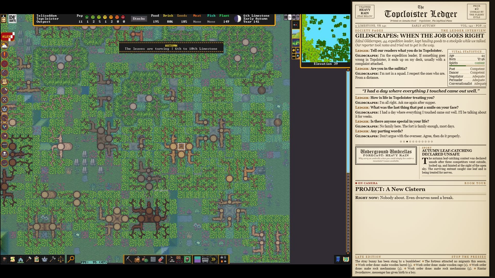
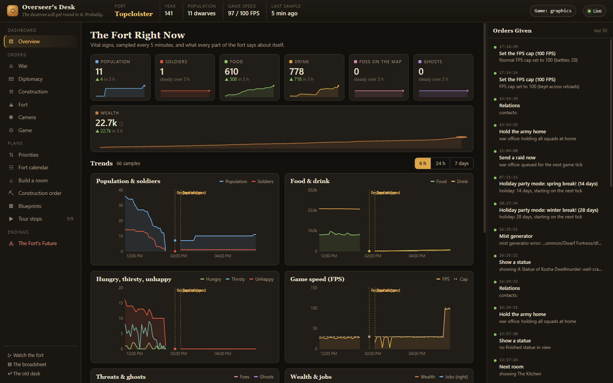

# df-ai: Steam Edition

**Watch Dwarf Fortress play itself.** df-ai is a DFHack plugin that runs a whole fortress on its own: it digs the halls, builds the rooms, farms and brews, trades with caravans, raises an army and fights off whatever comes, while you watch.


*A fort run entirely by df-ai, live on [twitch.tv/laserjetlab](https://twitch.tv/laserjetlab), with the Herald newspaper overlay on the right.*

This is a port of [BenLubar's df-ai](https://github.com/BenLubar/df-ai) to the modern Steam version of Dwarf Fortress, plus a set of helper scripts that make the AI's forts last longer.

| Works with | Version |
|---|---|
| Dwarf Fortress | **53.17** (Steam) |
| DFHack | **53.17-r1** |
| Windows | 10 or 11 |

> DFHack plugins only load into the exact game and DFHack versions they were built for. If Steam updates Dwarf Fortress, wait for a matching df-ai download (see [Keeping it working](#keeping-it-working)).

---

## Install (about 5 minutes)

### 1. Get the game and DFHack

1. Install **Dwarf Fortress** from Steam.
2. Install **DFHack** from Steam. It's free: search the Steam Store for "DFHack".
3. Start Dwarf Fortress from Steam **once**, then quit. This lets DFHack set itself up. (You'll see extra DFHack windows and buttons; that means it worked.)

### 2. Get df-ai

1. Open the [**Releases**](https://github.com/thegaryleonard/DF-AI-Steam-edition/releases) page and download the newest `df-ai-...-DF53.17.zip` (under *Assets*).
2. Right-click the zip and choose **Extract All…**.
3. Quit Dwarf Fortress if it's running.
4. In the extracted folder, double-click **`INSTALL.bat`**.
   - If Windows shows *"Windows protected your PC"*, click **More info**, then **Run anyway**. Windows shows this for any downloaded script.
   - The installer finds your game through Steam, copies df-ai in, and keeps a backup of any file it replaces. **Your saves are never touched.**
   - If it can't find the game, it asks for the folder. In Steam, right-click Dwarf Fortress, choose **Manage**, then **Browse local files**, and copy that folder's address.

## Play

1. Start Dwarf Fortress from Steam.
2. Create a world (or use one you have) and **embark** as usual.
   - Any embark works. These help: trees, a river or brook, and no "aquifer" warning on the embark screen (aquifers flood forts).
3. When your fort appears, press the **`` ` ``** key (top-left of the keyboard, under Esc) to open DFHack's command box. Type:

   ```
   enable df-ai
   ```

   Press **Enter**, then close the box.
4. That's it. df-ai plans the fort (the game may freeze for a few seconds while it thinks), unpauses, and gets to work. The seven dwarves are on their own.

### Commands

Type these in the same DFHack command box:

| Command | What it does |
|---|---|
| `enable df-ai` | Start the AI in this fort |
| `disable df-ai` | Stop it and take over yourself |
| `ai` | What the AI is doing right now |
| `ai report` | Write a full report to `df-ai-report.log` in the game folder |
| `dfai-priorities` | The fort's priority list (food, drink, defence, then the big projects) |
| `dfai-watchdog` | Anything stuck: stalled projects, deaths and their causes, missing water |
| `dfai-fps set 60` | Normal game speed (frames per second, 5-200; default 100) |
| `dfai-fps battle 30` | Game speed during fights (default 20, so you can follow them) |
| `dfai-fps dynamic off` | Always run at the normal speed |

## What it does

- **Builds the whole fort** from plans: a central staircase, bedrooms, dining halls, workshops, stockpiles, farms, a tavern, temple, library, hospital, tombs and more.
- **Runs the economy**: labour assignments (through DFHack's `autolabor`), work orders, farming and brewing, caravan trading.
- **Defends it**: makes squads, arms them, trains them, sends them at invaders and dangerous wildlife, and posts archers. Metal bolts go to the fighters; bone and wood bolts are used for training.
- **Puts first things first** (the helper scripts): food and drink before big mining jobs, water from the caverns when there's none on the surface, a daily health check that fixes small problems, and a watchdog that reports anything stuck.
- **Big projects** once the fort is settled: a curtain wall, bolt-thrower bunkers, a mist generator over the tavern, a sealed execution pit with a refuse crusher.
- **Diplomacy, slowly**: no messengers or raids until the fort has 100 citizens and armoured soldiers.

The helpers start by themselves in forts where you've run `enable df-ai`. Forts you play yourself are left alone.

## Settings

df-ai's settings are in **`dfhack-config\df-ai.json`** inside the game folder. Open it with Notepad; every setting has a comment above it explaining what it does. Restart the game after changing it.

Useful ones:

- `"camera": true` makes the camera follow interesting dwarves.
- `"random_embark": true` (experimental) has df-ai pick a world and embark by itself from the title screen, and start a new fort when one falls.
- `"direct_trade"` / `"manage_justice"`: set either to `false` if you'd rather handle trading or justice yourself.

## Troubleshooting

**Typing `enable df-ai` does nothing / says "No such plugin"**
- Make sure DFHack is installed from Steam and you've started the game once since.
- Run `INSTALL.bat` again (it's safe to repeat).
- Check your versions. In the DFHack command box, type `lua print(dfhack.getDFHackVersion(), dfhack.getDFVersion())` and look in the DFHack console window. It must say `53.17-r1` and `v0.53.17`.

**"could not fit any blueprint plan to this map"**
The embark is too rugged or cramped for df-ai's fort plan. Embark somewhere flatter and try again.

**The fort is flooding**
You embarked on an aquifer. Start a new fort somewhere without the "aquifer" warning.

**Dwarves are dying of thirst**
The fort has no water anyone can reach. The helpers zone surface water, and build a well over cavern water once the miners find the caverns. A brook or river on the embark avoids the problem entirely.

**The game is slow**
df-ai thinks a lot in big forts. Lower the speed with `dfai-fps set 50`, or try a smaller embark.

**Windows blocked the installer**
Click **More info**, then **Run anyway**. If the plugin is still blocked: in the game folder, open `hack\plugins`, right-click `df-ai.plug.dll`, choose **Properties**, tick **Unblock**, and click **OK**.

**Something else**
`df-ai.log` in the game folder says what the AI was thinking. [Open an issue](https://github.com/thegaryleonard/DF-AI-Steam-edition/issues) with that file and a description.

## Keeping it working

Steam can update Dwarf Fortress or DFHack at any time, and a new version stops df-ai loading until a matching df-ai comes out. To stay in control: in Steam, right-click **Dwarf Fortress**, choose **Properties**, then **Updates**, and set it to **"Only update this game when I launch it"**. Do the same for **DFHack**.

## Uninstall

Double-click **`UNINSTALL.bat`** from the same download. It removes only df-ai's files; your saves and settings stay.

---

## For streamers: the unattended stream kit

This repo also holds the setup behind the [laserjetlab](https://twitch.tv/laserjetlab) 24/7 stream. It's in [`supervisor/`](supervisor/), it's more involved, and it's meant for people comfortable with Python:

- **Game manager** (`dfai_supervisor.py`): restarts the game after a crash, reloads the fort, and embarks a new fort when one falls. Sites with an aquifer, or where df-ai can't fit its plan, are rejected automatically.
- **The Herald** (http://localhost:8765): a newspaper overlay for OBS with breaking news, recaps of the last few hours, battle reports, obituaries and comics.
- **The Overseer's Desk** (http://localhost:8767): a local control panel with live charts and buttons. It can send a raid, hold the army, set game speed, reorder fort priorities, preview and import blueprints, and retire the fort.
- Spectator camera, room tours, and an ASCII/graphics schedule.



See [`supervisor/README.md`](supervisor/README.md). The desk and the Herald only listen on your own PC (127.0.0.1).

## Building from source

df-ai is built as an external DFHack plugin with Visual Studio 2022 (MSVC), like DFHack itself:

1. Check out DFHack at tag `53.17-r1` with submodules.
2. Put this repo at `plugins/external/df-ai` (a junction is fine), and add `add_subdirectory(df-ai)` to `plugins/external/CMakeLists.txt`.
3. Configure DFHack (`-DDFHACK_BUILD_ARCH=64 -DCMAKE_BUILD_TYPE=Release`), then build the targets `df-ai`, `dfai_missions` and `dfai_portrait`.

`supervisor/build-local.sh` does all of that (`install` also hot-swaps the plugin into a running game), and `tools/release/make-release.sh` builds the player zip that `INSTALL.bat` comes in.

## Credits

- The original **df-ai**: [BenLubar](https://github.com/BenLubar/df-ai) and contributors, building on jjyg's Ruby AI. See the [df-ai wiki](https://github.com/BenLubar/df-ai/wiki) for how the AI thinks.
- Steam-edition port, helper scripts and stream kit: [thegaryleonard](https://github.com/thegaryleonard).
- [DFHack](https://github.com/DFHack/dfhack), and Bay 12 Games for **Dwarf Fortress**.

License: see [LICENSE](LICENSE).

[](https://xkcd.com/1223/)
